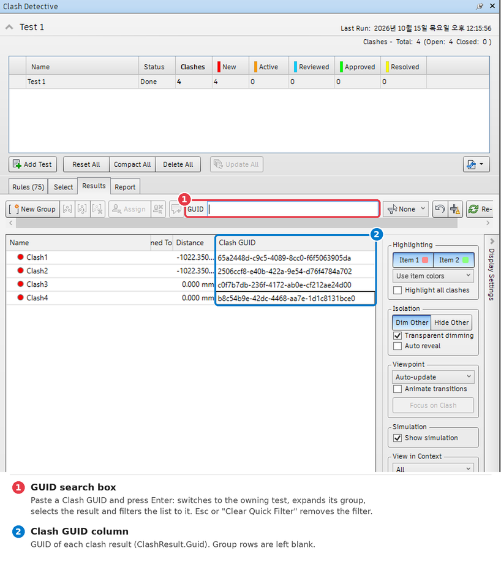

# Navisworks ClashGUID Visualizer

An add-in for Autodesk Navisworks Manage 2025 that adds two things to the **Clash Detective › Results** tab:

- **Clash GUID column**: shows each clash result's GUID (`ClashResult.Guid`) in the results grid. Group (parent) rows are left blank.
- **GUID search box**: paste a GUID and press Enter to jump to that result.
  - If the result belongs to another clash test, the add-in switches to that test.
  - If the result is inside a group, the group is expanded.
  - The result is selected (highlighted, viewpoint updated as on a normal click), and the tab's built-in Quick Filter narrows the list to that result.
  - Press `Esc`, or **Clear Quick Filter** on the yellow banner, to remove the filter.



## Requirements

| Item | Version |
| --- | --- |
| Autodesk Navisworks | **Manage 2025 only** (Simulate 2025 is targeted by the bundle but untested) |
| OS | Windows 10/11 x64 |

Other Navisworks versions are not supported. See [How it works](#how-it-works).

## Install

No administrator rights needed. The add-in is installed for the current Windows user.

1. Download this repository (**Code › Download ZIP**) and extract it.
2. Close Navisworks.
3. Run `install.bat` in the extracted folder.
   It copies `bundle/ClashGuidVisualizer.bundle` to `%APPDATA%\Autodesk\ApplicationPlugins\` and unblocks the files (Windows marks files from a downloaded ZIP, and Navisworks would not load the DLL otherwise).
4. Start Navisworks.

To upgrade, close Navisworks and run the new version's `install.bat`; it replaces the installed copy.

## Usage

Nothing to click. The add-in loads with Navisworks and attaches automatically:

1. Open an NWD/NWF and open **Clash Detective → Results**.
2. Within a couple of seconds a *Clash GUID* column appears at the right end of the results grid, and a **GUID** search box appears in the button row above it.

It re-attaches by itself after Reset Columns or when the Clash Detective window is recreated.

## Uninstall

Close Navisworks and run `uninstall.bat`. It deletes `%APPDATA%\Autodesk\ApplicationPlugins\ClashGuidVisualizer.bundle`.

## How it works

The Navisworks .NET API offers no supported way to extend the Clash Detective results grid. This add-in (an `EventWatcherPlugin` loaded at startup) polls every 1.5 s for the Results grid and adds elements at runtime to the live Clash Detective UI (`Navisworks.Clash.Plugin.dll`, WPF with a Syncfusion `GridTreeControl`).

- **GUID column**: appends a `ResultColumn` to the Results tab view model's (`ResultsTabVM`) private column list `m_all_columns` and calls `RebuildCurrentDisplayColumns` (via reflection).
- **Search box**: inserts a TextBox into the `RightCommandButtons` panel of the Results tab layout.
- **Search**:
  - finds the result with `DocumentClashTests.ResolveGuid`;
  - switches test and selects the result through Clash Detective's own `IUIService.CurrentTest` and `ClashCurrentIssue.CurrentIssue`;
  - filters with `GuidQuickFilter`, a subclass of the existing `QuickFilter` mechanism.
- **No changes on disk**: Navisworks installation files are not modified. Removing the add-in restores the original behavior.

**Limitations**

- It depends on undocumented internals, so a Navisworks update or a different version may break it. In that case it shows one error message and disables itself for the session.
- Search supports exact GUID matches only.

## Build from source

Requirements: .NET SDK (6 or later) and a Navisworks Manage 2025 installation (for reference assemblies).

```powershell
cd src/ClashGuidVisualizer
dotnet build -c Release
# Different install path: dotnet build -c Release -p:NavisworksDir="D:\Autodesk\Navisworks Manage 2025\"
```

Copy the built `ClashGuidVisualizer.dll` to `bundle/ClashGuidVisualizer.bundle/Contents/2025/`, then run `install.bat`.

## Disclaimer

- This project is not affiliated with, endorsed by, or supported by Autodesk. Autodesk and Navisworks are trademarks of Autodesk, Inc.
- This repository contains no Autodesk or Syncfusion binaries. Builds reference your own Navisworks installation.

## License

[MIT](LICENSE)
